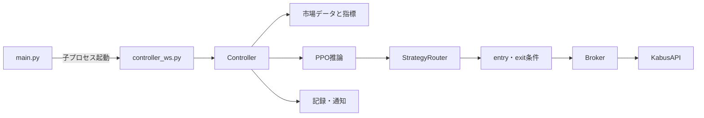
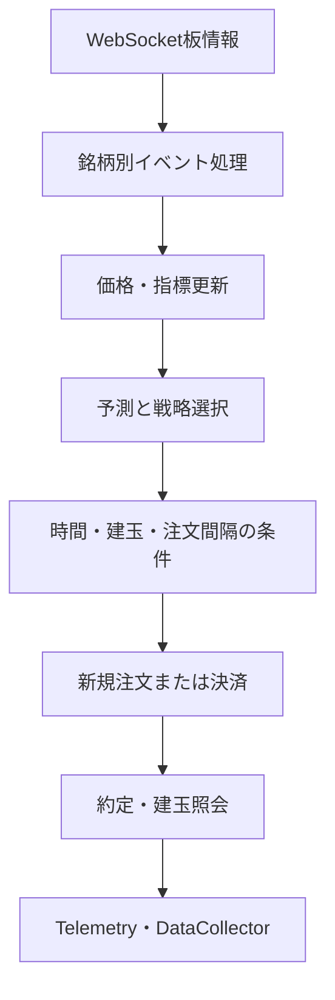
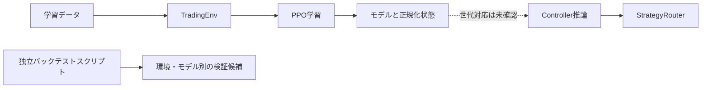

# 株ステ — 市場監視から注文制御までをつなぐ自動売買システム

株ステは、株価・板情報の取得、特徴量処理、PPOを用いた学習・推論、戦略判断、ポジション管理、証券API注文を一つのPythonプロジェクトに実装した個人開発の自動売買システムです。中心となる実装は簡易デモではなく、[統合起動](main.py#L32)、[WebSocket制御](controller_ws.py#L36)、[売買Controller](controller.py#L142)、[戦略Router](strategy_router.py#L57)、[Broker](broker.py#L60)、[証券API](kabus_api.py#L22)です。

> **安全上の注意:** このリポジトリには実注文へつながるコードがあります。READMEの閲覧や安全用コマンド以外で `main.py`、`controller_ws.py`、学習・バックテストスクリプトを直接起動しないでください。認証情報や実口座を設定して試すことも禁止です。現在の確認はソースの静的読解と隔離された検証に限られ、実注文や本番動作を確認したものではありません。

## プロジェクトの目的

市場データから売買判断までの流れを作り、強化学習による予測・戦略判断と、注文・損失制御を組み合わせることを目指したシステムです。主要処理はroot直下の実ソースにあります。市場監視からAPI注文までの経路と、複数世代の学習・検証用コードが同じリポジトリに保存されています。

この整備では本物のソースを残し、各ファイルがライブ経路に接続しているか、独立した補助実装か、静的には不明かを分けて案内します。**ファイルの存在だけで、稼働中・完成済み・性能確認済みとは判断していません。**

## リポジトリの構成

保存版にはroot直下の実装と複数世代の学習・補助スクリプトがあります。旧ソースパス91件（Python 87、BAT 3、`dashboard.html` 1）は最新ツリーに保持しました。77ファイルは元blobと同一で、14ファイルの資格情報候補・個人作業先の文字列17か所を最新版から除去しています。10,316件の生成物・ログ・データ・モデル・実設定・資格情報等は最新版の追跡対象から外し、原本・バックアップの保全とは分けています。過去履歴からの除去を意味しません。詳細は[バックアップと出自](docs/backup-and-provenance.md)へ。

元のスクリプト配置を維持しています。root importや相対パス、作業ディレクトリを変えると実装への参照が壊れる可能性があるためです。分類一覧は[ソースガイド](docs/source-guide.md)を参照してください。

## システム構成







図は主要な責務とデータの関係を示します。条件の評価順序・分岐の詳細はControllerの実ソースを参照してください。

ライブ経路の静的な入口は `main.py` → `controller_ws.py` → `Controller` です。WebSocketイベントは銘柄単位で処理され、Controller内の指標更新・推論・注文判断へ進みます。BrokerとAPIのコードには新規注文・取消・照会の実装があります。これらの図はコードから読める構造を示し、実行成功や現行サービスとの互換性を示すものではありません。

## 実装領域

| 領域 | 主なソース | 確認できる範囲 |
|---|---|---|
| 1. 市場監視 | [controller_ws.py](controller_ws.py#L80), [kabus_api.py](kabus_api.py#L201) | WebSocket接続・板情報処理・市場照会のコード。外部接続は未実施。 |
| 2. データ収集・特徴量 | [controller.py](controller.py#L731), [data_collector.py](data_collector.py#L15), [features.py](features.py#L9) | Controller内の指標更新と独立した特徴ベクトル・記録処理。全てが同じ経路で使われるわけではありません。 |
| 3. PPO学習・モデル管理 | [step2_env.py](step2_env.py#L22), [step2_env_universal.py](step2_env_universal.py#L16), [train_individual.py](train_individual.py#L121), [train_universal.py](train_universal.py#L208) | 異なる環境次元・学習スクリプトが並存。互換性は未確認。 |
| 4. 推論・戦略判断 | [controller.py](controller.py#L459), [strategy_router.py](strategy_router.py#L87) | Controller予測処理とStrategyRouter判定の静的接続を確認。 |
| 5. ポジション・リスク管理 | [controller.py](controller.py#L491), [broker.py](broker.py#L92) | entry可否、建玉上限、注文間隔、panic exit、TPSL・決済のコード。実環境での保護効果は未検証。 |
| 6. 証券API・自動注文 | [broker.py](broker.py#L119), [kabus_api.py](kabus_api.py#L143) | BrokerとAPIの注文・照会・取消実装。外部接続・実注文は未実施。 |
| 7. ログ・監視・障害対応 | [telemetry.py](telemetry.py#L20), [notifier.py](notifier.py#L43), [data_collector.py](data_collector.py#L15) | 状態保存、通知、収集、再試行・エラー処理のコード。送信・復旧は未検証。 |
| 8. バックテスト・検証 | [run_backtest.py](run_backtest.py#L51), [backtest_rules.py](backtest_rules.py#L42) | 実装は存在しますが、ライブ経路とは独立したスクリプトです。成績は報告しません。 |

## 技術スタック

| 用途 | ソース上に見える技術 | バージョン状態 |
|---|---|---|
| 強化学習 | Stable-Baselines3 PPO、Gymnasium、PyTorch | 固定版・互換版は未確認 |
| 数値処理 | NumPy、pandas、pandas-ta | 固定版・特徴量互換は未確認 |
| リアルタイム通信 | websocket-client系import、requests/urllib3 | 外部接続・サービス互換は未検証 |
| データ取得/補助 | jquantsapi、yfinance、Google API系import | root内の補助コードを含む。live経路とは区別が必要 |
| 設定・記録 | YAML、JSON、CSV等 | 実設定・生ログは検査対象に含めていません |

これはPythonソースのimportから拾った技術名です。依存がインストール済みであることや、全てが現在のlive経路で必要であることを示しません。依存の詳細は[依存関係](docs/dependencies.md)を参照してください。

## ソースを読む順番

1. [起動処理](main.py#L32) と [WebSocket Controller](controller_ws.py#L36) で入口を確認します。
2. [Controller](controller.py#L142) で市場イベント、推論、注文条件、記録の責務を追います。
3. [StrategyRouter](strategy_router.py#L57)、[Broker](broker.py#L60)、[KabusAPI](kabus_api.py#L22) の順に判断から通信まで読みます。
4. PPO学習・環境の違いは[学習とモデル](docs/training-and-models.md)、検証の限界は[制約と未検証事項](docs/limitations.md)を確認します。

## 技術的な課題

- WebSocketの銘柄別イベント処理、別スレッド、共有状態、注文間隔などが絡み、単一の「モデル予測」だけでは実システムの挙動を説明できません。
- Controller、Broker、APIの初期化や呼出しには外部I/O、認証、モデル/Pickleロードへ進むコードがあります。通常起動を使わずに確認できる検証境界が必要です。
- 学習環境、特徴ベクトル、モデル名と保存先の世代が混在しています。学習時と推論時の互換をソース名だけで決められません。
- 生成ログや大量データを最新版のソース紹介から分離しつつ、履歴保全と最新追跡対象の整理を同時に扱う必要があります。

## 重要な互換性・運用上の未解決点

- `step2_env.py` の観測空間は25次元、`step2_env_universal.py` は18次元です。どちらも `TradingEnv` という同名クラスです。`features.py` のentry/exit補助ベクトルは9/10要素で、これらの環境観測空間とは別仕様です。
- `train_individual.py` は `step2_env_universal.py` の環境をimportします。ファイル名から25次元環境を使うと推測できません。
- 学習コードにはv20系とv23系のモデル参照があります。tree上のモデル名だけでは、学習環境・正規化状態・推論時の互換を確定できません。
- `model_registry.py` の既定保存先と、保存済み資産のディレクトリ名が一致していません。詳細は[学習とモデル](docs/training-and-models.md)を参照してください。
- `EntryDecider`、`ExitDecider`、`RiskSizer` はファイルに定義されていますが、root Python内での静的な利用は確認できていません。ライブのrisk制御として紹介していません。
- バッチファイルの参照先の一部が保存版にありません。依存ライブラリのバージョンも固定されていません。

## 閲覧・安全な検証

この整備で追加した安全用入口は、人工データとMockを使う監査・テスト・シミュレーション用です。新しいMock処理は後から作成した補助検証であり、元のPPO推論、証券API連携、本番売買機能、過去の取引成績を再現しません。

```text
python -I tools/run_safe.py audit
python -I tools/run_safe.py tests
python -I tools/run_safe.py simulate
```

隔離した環境での手順は[再現手順](docs/reproduction.md)と[検証手順](docs/verification.md)に従ってください。独立ファイルの検査には、入力先に空の結果ディレクトリを用意して次の隔離確認を使います。

```text
sh tools/verify_isolated.sh . <空の結果ディレクトリ>
```

`<空の結果ディレクトリ>` は空ディレクトリのパスを表す置換箇所です。元の自動売買入口や実モデルを直接起動しないでください。

## 開発記録と貢献の範囲

約半年の実運用については本人申告として扱います。保存版のソースだけでは稼働期間・口座・取引成績を独立して裏付けられないため、実績や性能値は記載していません。

元コードのファイルごとの人間・AIの役割は、commit author情報だけでは確定できません。本整備の依頼・判断は本人が行い、このREADMEと技術説明の作成にはCodexを使用しました。元コード全体のAI生成率や本人寄与率は推定していません。

## 技術資料

- [アーキテクチャ](docs/architecture.md) — 起動・市場監視・推論・注文のつながり
- [ソースガイド](docs/source-guide.md) — 実装ファイルとmain経路・独立スクリプトの区別
- [学習とモデル](docs/training-and-models.md) — PPO環境、観測次元、モデル世代
- [リスクと注文](docs/risk-and-orders.md) — entry/exit条件、Broker、証券API
- [依存関係](docs/dependencies.md) — ソースから確認したimportと再現性の制約
- [制約と未検証事項](docs/limitations.md) — 主張できる範囲と未確認点
- [セキュリティ](docs/security.md) — 秘密情報、履歴、公開前の課題
- [再現手順](docs/reproduction.md)
- [検証手順](docs/verification.md)
- [バックアップと出自](docs/backup-and-provenance.md)

ソース対応の全体表は [docs/source-map.json](docs/source-map.json) です。履歴保全と復元情報は[バックアップと出自](docs/backup-and-provenance.md)を参照してください。
