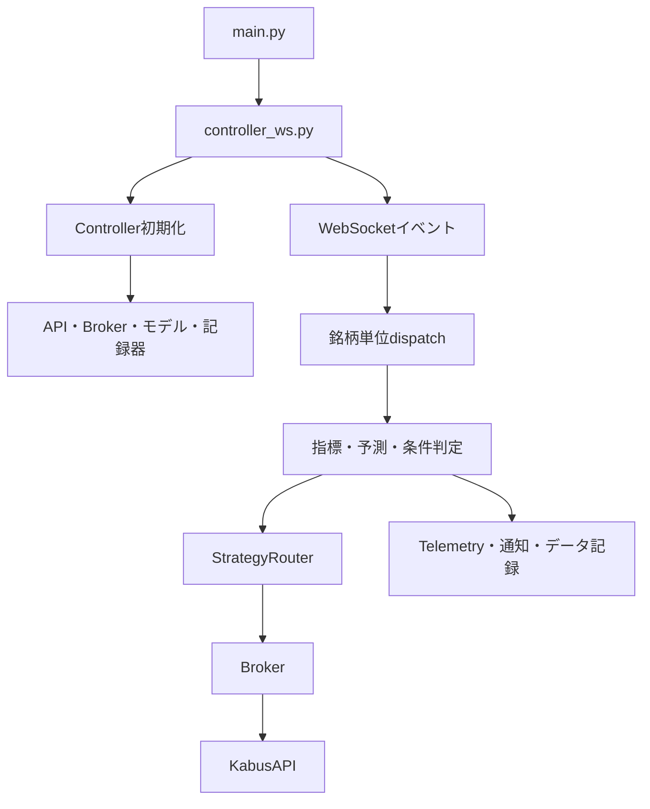

# アーキテクチャ

## 対象

この資料は `main` の保存版を基準に、root直下の実装を読み解いた構造案内です。構文と静的なimport/call関係から導いており、実行時動作・外部API互換・取引結果は検証していません。

## 起動とライフサイクル

1. [`main.py`](../main.py#L32) は統合起動処理です。`controller_ws.py` を子プロセス起動する記述があります。
2. [`WebsocketController`](../controller_ws.py#L36) は [`Controller`](../controller.py#L142) を継承します。親初期化は設定・Broker/API・ModelRegistry・DataCollector・Notifier等を構成し、モデル/Pickleロード経路も含みます。
3. [`WebsocketController.run`](../controller_ws.py#L80) はAPI認証・銘柄登録・WebSocket開始の経路を持ちます。メッセージは `_on_message` から銘柄別処理へ渡り、親の `Controller.process_symbol` に委譲されます。
4. Controllerは指標更新、予測、entry/exit条件、Router判定、注文制御を担い、記録・通知も呼び出します。
5. [`Broker`](../broker.py#L60) は注文・決済・建玉同期、[`KabusAPI`](../kabus_api.py#L22) はAPI認証・照会・注文・取消を担います。

これらのクラスやメソッドを生成・直接呼出しすると、モデルロードや外部I/Oへ進む可能性があります。ライフサイクルを読解するためにコードを起動しないでください。

## 概念図

図はコード上の責務と参照を示すもので、実行順の全分岐・非同期時系列を形式検証したものではありません。

## Controllerの責務

[`controller.py`](../controller.py#L142) に注文系の中心処理が集約されています。

- `_predict_with_confidence` が推論を扱う。
- `_can_new_entry_now`、`_can_short_entry_now`、`_respect_max_open_positions`、`_can_attempt_entry` が新規注文の条件を扱う。
- `_check_panic_exit`、`_check_tpsl_fast`、`_execute_exit` が強制終了・損切り/利確確認・決済に関わる。
- `_execute_trade` が通常の注文選択と `Broker` 呼出しを扱う。
- `StrategyRouter.decide` はControllerから呼ばれる。Routerの存在はentry/exit判断の全てがRouterだけで完結することを意味しない。

## 補助系とmain経路

- PPO学習環境とtrainスクリプト、バックテスト、データ準備、分析スクリプトは複数存在します。大半は`main.py`から静的に到達しない独立入口です。
- `features.py`、`entry_decider.py`、`exit_decider.py`、`risk_sizer.py`はソースが存在しますが、root Pythonの静的import/call調査ではライブmain経路からの利用を確認できません。
- バッチ参照は一部の取得・スクリーニング・設定更新スクリプトをつなぎます。参照だけでは正常完走や安全を保証しません。

完全なファイル単位の対応は [`source-guide.md`](source-guide.md) と [`source-map.json`](source-map.json) を参照してください。

## 起動時に特に注意する理由

Controller初期化にはAPI/Broker生成、Notifier呼出し、PPO/Pickleロード経路があります。WebSocket側の起動処理には認証・銘柄登録・ネットワーク接続が含まれます。Paper設定の存在を外部通信遮断の証明とみなせません。オフライン確認には `tools/run_safe.py` の隔離入口だけを使い、対象のsafe runner実装と検証資料を先に確認してください。
